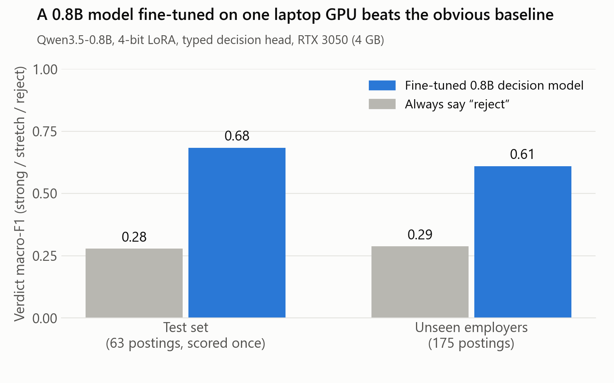
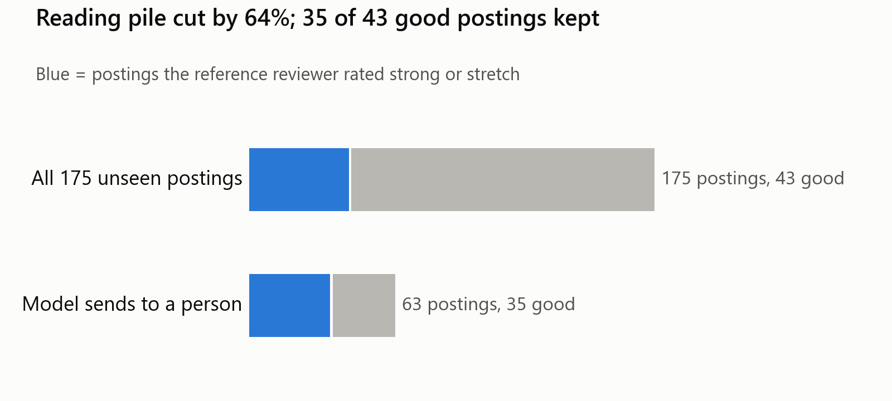
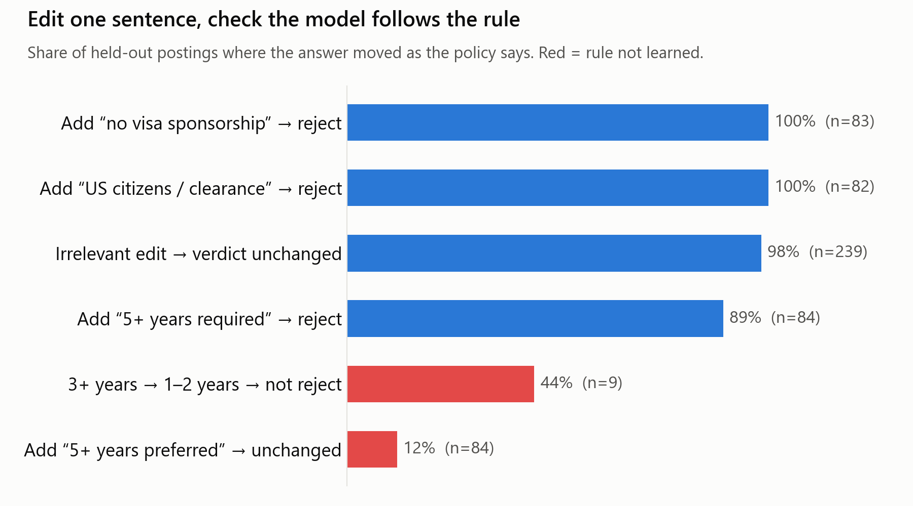

# Learning to build a typed-decision model

A model-building case study: fine-tune a small language model, attach a decision head, and measure whether its typed answers and probabilities are useful. The implementation uses Unsloth's `FastDecisionModel` with `unsloth/Qwen3.5-0.8B`, trained locally on a **4 GB RTX 3050 laptop GPU** under native Windows.

Job-posting triage is the experimental domain because it was the author's one real dataset. The goal is to learn dataset construction, teacher-label quality, constrained training, calibration, and evaluation. Success means demonstrating those practices honestly; deployment into a job-search workflow is incidental.

The model was trained on the author's own labelled job-search data, which is not published. Paths under `data/` and `outputs/` cited as sources below refer to those private files; [docs/DATA.md](docs/DATA.md) describes what is and is not in this repository.

## Motivation: decisions with a schema

[TypeSafe AI's Jev](https://typesafe.ai/) is the inspiration: typed decisions with probabilities that software can consume. This project uses the [Unsloth decision-model API](https://unsloth.ai/docs/basics/train-your-own-decision-model-with-unsloth), which adds a decision head to a language-model backbone. It trains a fresh Clef-style head and LoRA adapters through supervised learning, then calibrates the outputs. It does not reproduce Jev's proprietary training procedure or claim equivalent capabilities.

Each example has a `state`, named `questions`, and typed `gold` answers. The state combines fixed private policy/context with posting metadata and a shortened description. The head answers the schema directly, with probabilities, rather than requiring a generated explanation to be parsed into labels.

The five questions in `scripts/build_decision_dataset.py::QUESTIONS` are:

| Question | Type | Meaning |
|---|---|---|
| `verdict` | `choice` | `strong`, `stretch`, or `reject` under the frozen policy |
| `needs_verification` | `noul` (yes/no) | **Dropped (2026-10-29).** Was: a decisive text gate remains unresolved, with no independent rejection already established |
| `sponsorship_blocked` | `noul` | An explicit sponsorship or unrestricted-authorization restriction |
| `clearance_or_citizenship_required` | `noul` | An explicit citizenship, residency, or clearance requirement |
| `min_years` | `score` | Ordered buckets: unstated/zero, 1–2, 3–4, or 5+ required years |

The years policy uses the lower bound of a required range; preferred years are not a gate. A 3+ required-years minimum rejects unless the posting explicitly permits the relevant alternative experience. A lower minimum does not automatically reject or cap a verdict below `strong`. These are dataset-policy definitions, not general hiring rules.

The builder maps an explicit labeller `unknown` on a boolean field to false (“not established”); absent fields are omitted. That distinction matters when interpreting uncertainty. `needs_verification` was a separate supervised question, not a synonym for low model confidence or a live-site availability check. It is still trained into the full-e3 head, but it is dropped from serving and from the reported results, because no attempt to make it work passed a fair test (see below).

## Pipeline

<picture>
  <source media="(prefers-color-scheme: dark)" srcset="docs/figures/pipeline-dark.svg">
  <source media="(prefers-color-scheme: light)" srcset="docs/figures/pipeline-light.svg">
  
</picture>

Rendered with [Pele](https://pele.run/) from the editable [Mermaid source](docs/figures/pipeline.mmd), with light and dark themes matching the project figures.

The receipts provide an evaluation reference distinct from the teacher labels. They are historical **agent reviewer judgments**, not ground-truth human preferences. The pipeline retains their provenance rather than treating every source as interchangeable.

## Data and teacher labelling

This is frontier-to-small-model distillation through hard labels, not teacher-logit matching. The v3 reference used a fresh `gpt-6-astra` call per posting with a frozen policy. Budget pressure motivated a v4 bake-off of cheaper labellers using the same underlying prompt and schema, followed by selective stronger review.

### Labeller bake-off

The comparison used 150 postings, balanced at 50 per receipt class, drawn across the existing splits. Consequently these raw agreements describe an enriched comparison set, not the natural class distribution. The Astra reference agreed with receipts on 80.0% of this subset.

| Labeller | Valid labels / 150 | Agreement with Astra | Agreement with receipts | Estimated dollars / 1,000 labels |
|---|---:|---:|---:|---:|
| gpt-6-luna | 150 | 82.0% | 73.3% | $1.61 |
| claude-haiku-5-5 | 150 | 78.0% | 68.0% | $1.64 |
| glm-5.3-flash | 150 | 78.0% | 74.7% | $2.23 |
| minimax-m3 | 150 | 68.7% | 67.3% | $3.08 |
| kimi-k2.7-code | 150 | 79.3% | 75.3% | $14.07 |
| glm-5.3 | 149 | 79.3% | 76.7% | $20.09 |
| gemini-4-argon, partial | 43 | 26.0%* | 22.0%* | $32.49 |

*The source table counts missing labels as disagreement. On Gemini's completed subset alone, agreement was 90.7% with Astra and 76.7% with receipts; its run stopped at a quota guard. Its full-table row is not a like-for-like capability ranking.* Source: `data/labeling/v4/BAKEOFF.md`.

No candidate met both selection criteria: at least 88% agreement with Astra and receipt agreement within 2 percentage points of Astra. Luna was selected by the fallback rule of highest full-set Astra agreement, with low meter use and no parse failures. Its strong-class recall against receipts was only 52%, an important source of teacher bias.

A batching pilot grouped 5 postings per call over 100 postings. Verdict agreement with single-call labels was 87%, below the 93% acceptance gate, so production labelling stayed single-call. Valid JSON alone did not establish equivalent labels. Source: `data/labeling/v4/PILOT-5.md`.

### Agreement and tie-break merge

Luna labelled 1,500 bulk postings. Its 251 `strong`/`stretch` labels received a GLM second opinion: 188 verdict agreements, 57 disagreements, and 6 missing valid GLM labels. The resulting 63 unresolved cases went to Astra. Luna's 1,249 rejects were retained without second review. This asymmetric audit can preserve false negatives from the cheaper teacher.

The current merge is complete: **30 strong, 199 stretch, 1,271 reject**. Older narrative reports describe the intermediate pending queue; the current `data/labeling/v4/bulk-final-summary.json` and training manifest supersede those counts. Agreement selects a final label according to the merge rule; it is not a guarantee that every auxiliary field was independently adjudicated.

### Cost and quota constraints

The v3 ledger recorded 7,874,927 input tokens against an 8,000,000 daily and 18,000,000 total cap. Cached input counts toward that accounting. The later bulk tie-break ledger charged 897,177 input tokens, including conservative charges for unknown usage, under a 1,000,000-token cap. These are quota-accounting totals, not inference cost measurements.

The initial v4 report estimated approximately $10.5 across its runs, including roughly $2.59 for 1,612 production labels; the later GLM second pass added an estimated $5.05. Those figures are estimates from text length, assumed reasoning allowance, and listed rates—not an invoice. The transport returned no token usage. Shared quota limits were an operational constraint; quota usage does not reconcile directly with these dollar estimates. Sources: `data/labeling/v3/budget.json`, `data/labeling/v4/REPORT.md`, and `data/labeling/v4/tiebreak-budget.json`.

### Final training dataset

| Partition | Rows | Role |
|---|---:|---|
| Train | 562 | Teacher-labelled examples |
| Bulk | 1,500 | Additional teacher-labelled training examples, unweighted |
| Validation | 70 | Calibration and model selection; 63 receipt verdicts |
| Test | 70 | Final evaluation; 63 receipt verdicts |

The full run trained on **2,062 rows**. Each held-out split contains 7 teacher-filled verdicts outside the receipt-only headline metrics. Auxiliary questions use teacher labels. The builder excludes held-out posting IDs and normalized employers, including aliases, from train/bulk. Stratum weights are retained as metadata but were not applied during training: population reweighting would further emphasize rejection. Source: `data/training/manifest.json` and the dataset builder.

## Model and training on a small Windows laptop

| Setting | Recorded full run |
|---|---|
| Backbone | `unsloth/Qwen3.5-0.8B`, loaded in 4-bit |
| Decision head | Fresh Clef `JointSchemaHead`, width 512 |
| Adaptation | LoRA rank/alpha 16; dropout 0 |
| Schedule | 3 epochs; 774 optimizer steps; cosine learning-rate schedule |
| Batch | 1 example, gradient accumulation 8 |
| Learning rates | LoRA `2e-4`; head `1e-4` |
| Precision / checkpointing | bf16; standard GPU recomputation (`--grad-ckpt gpu`) |
| Sequence / posting budget | 2,048 total tokens; 950 description tokens |
| Seed | 3407 |
| Training time | 8,996.7 seconds, about 2.5 hours |
| Peak reserved VRAM | 2.15 GiB training; 2.55 GiB overall |
| Validation prediction time | 0.482 seconds per posting for the question set |

These are measurements of this run, not general hardware guarantees or serving benchmarks. Sources: `outputs/full-e3/results.json`, `training/ENV.md`, and `training/SMOKE.md`.

The recorded environment was Windows 11, Python 3.12.16, PyTorch 2.14.1+cu130, Unsloth/Unsloth Zoo 2026.10.9, Transformers 5.17.0, and triton-windows 3.9.0.post30. See [the environment notes](training/ENV.md) for the remaining versions. Current upstream documentation is not a version-pinned reference; the checked local implementation and saved run configuration ground the details here.

Practical lessons from fitting the pipeline:

- **Host memory can be the bottleneck.** Gradient-checkpoint offload can stall when host RAM is full even while VRAM has room. The successful full run used `--grad-ckpt gpu`, which selects standard recomputation rather than Unsloth's host offload. The saved configuration confirms that choice; it does not itself measure the earlier stall.
- **Budget the question encoding too.** The smoke run allowed 1,400 posting tokens, but the schema cost about 625 tokens in addition to the fixed context. Unsloth then tail-cut 386/562 train and 59/70 validation states. The rebuilt dataset uses a 950-token description budget inside the 2,048-token limit.
- **Prefer deliberate cuts to arbitrary tail loss.** The builder keeps opening context, prioritizes sentences about eligibility/experience/location, deprioritizes boilerplate, and marks omitted spans. This is heuristic information preservation, not a guarantee that every decisive sentence survives. The final run still reports 41 training and 1 validation truncations in Unsloth's build report.
- **A “tokenizer” may be a processor.** Keep the object returned by `FastDecisionModel.from_pretrained` for the decision API. For custom text-only token counting, unwrap its `.tokenizer` when present. The local decision implementation handles that distinction internally; the dataset builder separately uses `AutoTokenizer`.
- **Native Windows worked.** The recorded installation used bundled CUDA wheels and triton-windows without a separately installed CUDA toolkit. Initial imports/kernel compilation can be slow; do not equate silence with a training failure.

## Evaluation design

Headline verdict scores use only non-`needs_information` reviewer receipts. Accuracy measures exact agreement; macro-F1 gives each verdict class equal weight. Always-reject is essential because rejection dominates the data. Auxiliary tasks are compared with their majority-class baselines and teacher labels, not silently presented as receipt-validated truth.

The model was selected on validation, calibrated there, saved, and reloaded. `eval-val.json` reproduces the reported validation verdict metrics. The final model's original test evaluation was run once and is now a fixed reported result, not a tuning target.

**“Scored once” does not mean historically untouched.** `data/labeling/v3/AGREEMENT-v3.md` explicitly says test had already been inspected during v2, and the later teacher bake-off included test examples. Receipts also informed earlier policy/prompt work. There is no claim of a pristine end-to-end blind benchmark. The training script reads test IDs for a disjointness assertion but does not use test rows for optimization or calibration.

Calibration reports **ECE 0.031** from the validation calibration routine, cross-fitted across rows and pooled over the typed decisions. This is not test ECE, verdict-only ECE, or a guarantee of reliable rare-class probabilities. The final calibration parameters use validation data; the verdict tables are separate post-calibration predictions. A small, imbalanced validation set and repeated validation-based selection limit how far the result generalizes.

## Results





Figures: `scripts/make_figures.py`. The triage figure counts the plain model on val2: everything not predicted `reject` goes to a person.

| Model / baseline | Validation accuracy | Validation macro-F1 | Test accuracy | Test macro-F1 |
|---|---:|---:|---:|---:|
| Always reject | 0.698 | 0.274 | 0.714 | 0.278 |
| Smoke run | 0.698 | 0.274 | — | — |
| **Full run, unweighted bulk** | **0.810** | **0.691** | **0.762** | **0.683** |
| Oversampled run | 0.762 | 0.634 | — | — |

Each headline split has **n=63** receipt-labelled examples. Sources: `outputs/smoke/results.json`, `outputs/full-e3/results.json`, `outputs/full-e3/eval-val.json`, `outputs/full-e3/eval-test.json`, and `outputs/full-e3-os/results.json`. Dashes mean no test result is reported here.

The full model improves on the rejection prior and learns input-dependent distinctions. Nevertheless, each headline split has only 6 `strong` examples: validation recalls 3/6 and test recalls 4/6. A single changed prediction has substantial impact. Employer clustering further reduces the independence of examples. There are no multi-seed confidence estimates.

`needs_verification` was a clear failure, and is now dropped (see Experiments): **zero positive predictions** on both held-out splits, despite 3 positive teacher labels in each. Its 0.957 accuracy simply equals the majority baseline. A good aggregate score must not hide an unusable question.

### External agreement check

A separate export was scored against an independent agent's historical verdicts. The `never_seen` cohort has **460 postings**, with **0.726 accuracy and 0.536 macro-F1**. It is a different comparison population and reference, not a replacement test score. Its 384 rejects imply an always-reject accuracy of **0.835**, calculated as 384/460: the model does not beat that external accuracy baseline. “Never seen” is the export's overlap classification, not evidence of a new employer-disjoint benchmark. Source: `data/raw/agent-export-20261028-2111/summary.json`.

The accompanying memory audit estimates **about 50 disagreements** involved rejection reasons unavailable in the supplied text, including closed/filled roles and staffing-employer status. That is an approximate qualitative audit observation, not a count reproducible from `summary.json` or the export's `NOTES.md`. Those notes document changing policy eras and potentially changed posting snapshots. Some disagreement therefore reflects missing information or different policy, as well as model error. Text-only training cannot recover facts the input never supplies.

## What failed, and what it taught

- The **60-step smoke test** learned the class prior: verdict performance equalled always-reject despite falling training loss. A fresh head needs more than a pipeline health check to establish useful learning.
- Repeating `strong` rows **3×** and `stretch` rows **2×** made validation accuracy and macro-F1 worse. Oversampling is not a substitute for additional representative evidence and reliable labels.
- Cheaper teacher labels introduced systematic bias; second opinions helped only where they were requested. Unreviewed rejects remain a blind spot.
- Rare uncertainty labels did not become useful merely because the head supported a yes/no output. Label semantics, positive coverage, and recall need their own evaluation.
- Tight sequence budgets make preprocessing part of the model. Truncation can remove the evidence the target label depends on.
- Calibration, label agreement, and real-world correctness are different properties. The external check makes the boundary of a text-only task especially visible.

## Experiments: more data and the needs_verification question

Two follow-up runs used the same recipe (Qwen3.5-0.8B 4-bit, rank 16, 3 epochs) and are documented in [training/EXPERIMENTS.md](training/EXPERIMENTS.md).

- **Exp 1, more data:** added roughly 460 verdict-only postings reviewed by an independent agent. 102 conflicting old labels were replaced, and 82 rejects whose reasons are absent from the posting text (closed roles, staffing employers) were dropped. Partial labels work: the installed Unsloth skips missing gold questions.
- **Exp 2, the weak `needs_verification` question:** used the Exp 1 data plus 45 weak "yes" examples. These came from the agent's "needs information" reviews, filtered to text-related reasons and mapped to `needs_verification = true` and `verdict = stretch`. Another 20 were held out.
- **New held-out set (val2):** 175 never-trained postings, employer-disjoint from both new training sets. The selection rule was fixed in advance: highest mean verdict macro-F1 over the original validation set and val2.

| Model | Val macro-F1 (n=62) | val2 macro-F1 (n=175) | Mean | val2 NLL / Brier |
|---|---:|---:|---:|---:|
| always reject | 0.273 | 0.287 | - | - |
| **full-e3 (reference)** | **0.691** | **0.609** | **0.650** | 0.648 / 0.365 |
| Exp 1: + more data | 0.682 | 0.603 | 0.643 | **0.583 / 0.337** |
| Exp 2: + verification positives | 0.653 | 0.476 | 0.565 | 0.747 / 0.448 |

Neither run beat the reference, so full-e3 stays the model and its single test result stands. Test was not re-scored.

- **More data from the same teacher tied on verdicts.** It did improve calibration on unseen postings. Label consistency, not row count, looks like the binding constraint.
- **`needs_verification` still never predicts "yes", even with 45 positives.** The forced `stretch` mapping also hurt verdict quality badly on val2. All three follow-up fixes were then tried (Exp 3–4 in EXPERIMENTS.md), and none works:
  - **Lowering the decision threshold** on full-e3 first looked like it worked: positive-class F1 0.68 at 0.075. That test was confounded. Its positives were export postings that are mostly stretch, while its negatives were original-val rows that are mostly rejects. On same-source negatives, the probability turned out to track "not a reject" rather than "unresolved gate".
  - **A fair test** used 20 weak positives and 175 resolved negatives from the same export, with the threshold chosen on a separate calibration split. Every model was barely above chance (ROC-AUC 0.57–0.66, best positive F1 0.23):
    - full-e3;
    - the decoupled retrain (explicit negatives for resolved export rows, no forced verdict, oversampled positives);
    - a short 4th-verdict pilot.
  - **The decoupled retrain** cut false positives the most, but it found fewer than half the positives.
  - **Conclusion:** the weak labels cannot teach this concept. Agent "needs information" reviews mix text-level ambiguity with checks outside the text.
  - **Decision (2026-10-29): the question is dropped.** Making it work would need hand-audited text-gate labels, which this project chose not to collect. full-e3 is kept unchanged rather than retrained without the question: the verdict comparisons above were all made with it in the schema. Posting requests to the server no longer return it, and the experimental threshold flag is removed.
  - **Exp 5, low confidence as "uncertain":** also not adopted. The model is only ever confident about rejects, so "uncertain" just means "maybe worth a look". It flags weak needs-information postings barely above chance (ROC-AUC 0.566). On val2 it sends 22 more postings to review to save 2 good ones.

On val2 the reference model's accuracy (0.737) is below always-reject (0.754), because three quarters of val2 are rejects. Macro-F1 is the metric that separates the models.

## Does it follow the rules? Counterfactual tests and explanations

Two checks on the validation splits only (val + val2, 245 postings), both scored with the GGUF model.

**Rule tests** ([training/RULE-TESTS.md](training/RULE-TESTS.md)) edit one sentence and check that the answer moves as the policy says.



- Explicit gates are learned perfectly: adding "no visa sponsorship" or "US citizens / clearance" sends 165 of 165 strong/stretch postings to reject.
- Irrelevant edits (company name, EEO text, a typo, benefits order) change the verdict in only 4 of 239 cases.
- **Shortcut:** "5+ years preferred, but not required" flips 71 of 84 good postings to reject. The model learned "5+ years" as a trigger and ignores "preferred".

**Sentence-occlusion explanations** ([training/EXPLANATIONS.md](training/EXPLANATIONS.md)) remove one sentence at a time and measure how much P(reject) moves.

Individual explanation examples are withheld because they contain private posting excerpts. Aggregate findings follow.

- On val, the top reject driver is a years, sponsorship or clearance sentence for 33 of 48 rejects.
- On val2 the keyword audit finds only 37%. Reading the rest shows real gates the keywords miss (written-out years, foreign locations, ITAR), but also clearly spurious drivers: section headers, dates, one-word labels. A clearance "beneficial but not necessary" still drives a reject, which mirrors the preferred-years failure.
- Where several reasons overlap, no single sentence matters, and occlusion cannot explain the decision.

**Demo:** `demo/` is an offline page that scores a pasted posting with the GGUF model and shows the typed answers and the sentence view ([demo/README.md](demo/README.md)).

## Serving

See [training/SERVING.md](training/SERVING.md).

- **Export:** `scripts/export_model.py` writes a merged 16-bit decision model (1.7 GB).
- **GGUF:** an 841 MB Q8_0 file runs on stock llama.cpp `llama-server` (b11982, `/v1/systemone`). It matches the merged model on all 70 validation verdicts and loads in 5.6 s instead of about 60 s.
- **Server:** `scripts/serve_decision.py` is a small standard-library HTTP server bound to 127.0.0.1.
  - It exposes `GET /health` and `POST /decide`, which takes either a ready `state` plus `questions` or a raw `posting`.
  - Every answer comes back typed, with calibrated probabilities, in the shape of a Decision API response.
  - A `--once` CLI mode covers scripting.
- **GPU sharing:** all GPU work runs through `scripts/gpu_lock.py`, so training and serving never share the 4 GB card.

Verification on the 70 validation rows, measured in a fresh process:

| Artifact | Answers matching the reference | Verdict acc / macro-F1 vs receipts | Load | Mean / p95 latency | Peak VRAM |
|---|---:|---:|---:|---:|---:|
| Adapter on 4-bit base | 350/350 (max prob diff 0.0) | 0.810 / 0.691 | 77 s | 0.38 / 0.40 s | 1.4 GiB |
| Merged 16-bit | 345/350 (all 5 differences are verdicts) | 0.810 / 0.723 | 68 s | 0.32 / 0.33 s | 1.9 GiB |

The merged model is not bit-identical. The adapter was trained against a 4-bit-quantized base, while merging folds it into the full-precision base. That shift moved 5 borderline verdicts, with a maximum probability difference of 0.41, and receipt metrics did not get worse. If exact reproduction matters, serve the adapter on the 4-bit base. For lower latency, use the merged model.

Operational lesson: the first merged export died silently after about 2 minutes, and nothing was logged. The most likely cause is host-RAM exhaustion during the merge, since only about 2 GB of 15.7 GB was free. A re-run with stdout and stderr captured to a log succeeded.

## Reproduce

### What a public clone can and cannot do

The model was trained on the author's own labelled job-search data, which is not published. The repository contains the code, tests, write-ups and figures; posting text, reviewer receipts, teacher labels, the candidate profile and the trained weights stay private. [docs/DATA.md](docs/DATA.md) lists exactly what is missing and the file formats you would need to supply.

| Step | Public clone | Needs |
|---|---|---|
| Run the unit tests | Yes | Python 3.12; pytest and psutil for the commands below |
| Regenerate `docs/figures/macro-f1.png`, `triage.png`, `rule-tests.png` | Yes | matplotlib (aggregate numbers are in the scripts) |
| Build a dataset, label, train, evaluate | With your own data | Your postings and labels in the documented formats, a CUDA GPU, the training environment below |
| Reproduce the published scores, serve or demo the published model | No | The private data and weights |

### 1. Tests and figures (no GPU, no data)

Commands are for PowerShell from the repository root; on other systems use `.venv/bin/python`.

```powershell
python -m pip install uv
python -m uv venv .venv --python 3.12
python -m uv pip install --python .venv/Scripts/python.exe pytest psutil==7.2.2
.venv/Scripts/python.exe -B -m pytest -q tests
.venv/Scripts/python.exe -B -m unittest discover -s scripts -p "test_*.py"   # labelling-pipeline tests

python -m uv run --no-project --with matplotlib python -B scripts/make_figures.py
python -m uv run --no-project --with matplotlib python -B scripts/make_rule_tests_figure.py
```

The figure scripts use the Segoe UI font; elsewhere matplotlib falls back to its default font. The individual explanation figure is withheld because it contains private posting excerpts.

To regenerate the pipeline diagram (Node.js 20 or newer; no Python or private data needed):

```powershell
npm ci --prefix tools/diagrams
npm run render --prefix tools/diagrams
```

Pele is pinned in `tools/diagrams/package-lock.json`. Theme colors and typography live in `tools/diagrams/render.mjs`; the generated SVGs are committed so GitHub needs no JavaScript to display them.

### 2. Training environment (CUDA GPU)

The recorded setup used uv-managed Python and installed PyTorch before Unsloth. These mirror the historical installation process, not a fully locked environment; package resolution can change. Compare installed versions with `training/ENV.md` before attributing a difference to the model.

```powershell
python -m pip install uv
python -m uv python install 3.12
python -m uv venv .venv --python 3.12
python -m uv pip install --python .venv/Scripts/python.exe torch torchvision torchaudio --index-url https://download.pytorch.org/whl/cu130
python -m uv pip install --python .venv/Scripts/python.exe unsloth --extra-index-url https://download.pytorch.org/whl/cu130 --index-strategy unsafe-best-match
```

For the exact versions used in the recorded runs, install from the pinned list instead:

```powershell
python -m uv pip install --python .venv/Scripts/python.exe -r requirements-lock.txt --extra-index-url https://download.pytorch.org/whl/cu130 --index-strategy unsafe-best-match
```

### 3. Build, train and evaluate with your own data

Copy the fictional profile and edit it to describe your candidate, then provide `data/processed/` and `data/labeling/` files as described in [docs/DATA.md](docs/DATA.md):

```powershell
New-Item -ItemType Directory -Force data/training
Copy-Item examples/state-profile.example.md data/training/state-profile.md

# Explicit budget matters: the builder's default is still 1400.
.venv/Scripts/python.exe scripts/build_decision_dataset.py --budget 950

# Use fresh output directories.
.venv/Scripts/python.exe -B scripts/gpu_lock.py -- .venv/Scripts/python.exe -B scripts/train_decision.py --max-steps 60 --grad-ckpt gpu --out outputs/repro-smoke
.venv/Scripts/python.exe -B scripts/gpu_lock.py -- .venv/Scripts/python.exe -B scripts/train_decision.py --with-bulk --bulk-weighting none --epochs 3 --batch-size 1 --grad-accum 8 --lr 2e-4 --head-lr 1e-4 --rank 16 --max-seq-length 2048 --seed 3407 --grad-ckpt gpu --out outputs/repro-full

# Reload and check validation only.
.venv/Scripts/python.exe -B scripts/gpu_lock.py -- .venv/Scripts/python.exe -B scripts/eval_decision.py --adapter outputs/repro-full/adapter
```

These are the commands behind the recorded full run. The smoke command uses the corrected data budget and GPU checkpointing, so it is a pipeline check rather than an exact recreation of the historical smoke failure. Appending `--test` to the evaluation command also scores test; score your own test split once, not as a tuning target. The serving, export, rule-test, explanation and demo commands are in `training/SERVING.md`, `training/RULE-TESTS.md`, `training/EXPLANATIONS.md` and `demo/README.md`; they need a trained adapter and, for GGUF, a decision-head-aware llama.cpp build.

Training writes the adapter/head, calibration configuration, metrics, and predictions beneath the chosen output directory. It does not automatically produce a served model. `data/`, `outputs/`, `.venv/` and model weight files are gitignored. This README intentionally contains only generic policy descriptions and aggregate results—no private context, posting text, identities, or individual decision history.

## License

The original code and documentation in this repository are available under the [MIT License](LICENSE). Third-party packages and base models retain their own licenses. Private datasets and trained weights are not distributed or licensed by this release.
